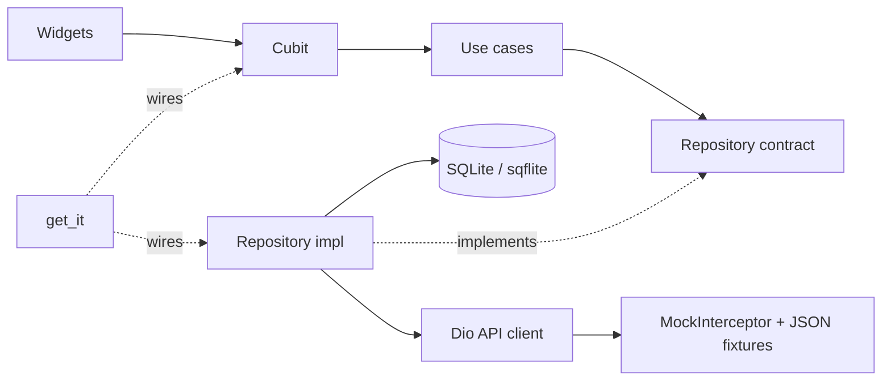

# flutter-field-inspection

An offline-first field inspection app built with Flutter. Inspectors fill in checklists on site, add photos and a sign-off signature, and the app syncs everything once the device is back online.

> 🚧 In progress: project setup, domain entities, local database and mock API are in place.

## Features

- [ ] Secure login with biometric unlock
- [ ] Inspection list and site details
- [ ] Checklists loaded from JSON templates (server-driven forms)
- [ ] Offline drafts with progress tracking
- [ ] Photo capture with notes and a sign-off signature
- [ ] Background sync queue with retry and backoff
- [ ] PDF inspection report
- [x] Local SQLite database with versioned migrations
- [x] Mock API served from JSON fixtures (no backend needed)

## Architecture

Clean Architecture, one folder per feature:

```
lib/
  core/            # database, network, dependency injection
  features/
    inspection/
      data/        # models, local + remote data sources, repositories
      domain/      # entities, repository contracts, use cases
      presentation/ # Cubits and widgets
```



The domain layer has no Flutter or package dependencies apart from `equatable`, so it is fully unit-testable. The app reads from SQLite first and treats the network as a sync target, which is what makes it work offline.

## Tech

Flutter · Dart 3 · flutter_bloc (Cubit) · get_it · sqflite · dio · Material 3 · GitHub Actions

## Run locally

```bash
flutter create . --platforms=android,ios,web   # first time only: generates platform folders
flutter pub get
flutter analyze
flutter test
flutter run
```

All API calls are answered by `MockInterceptor` from `assets/fixtures/`, so no backend or network is needed.

## How this was built

I designed the features, architecture and data model for this app and reviewed every change before merging. I used Claude as a coding assistant for parts of the implementation and tests. I can walk through any part of the codebase.
